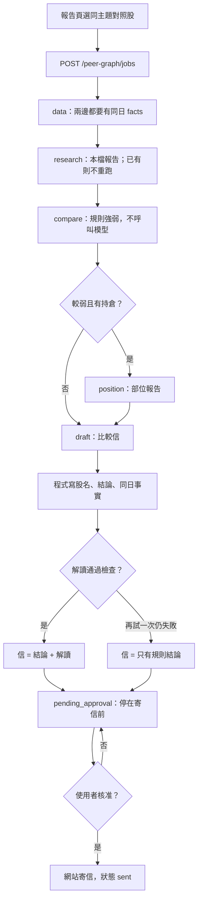
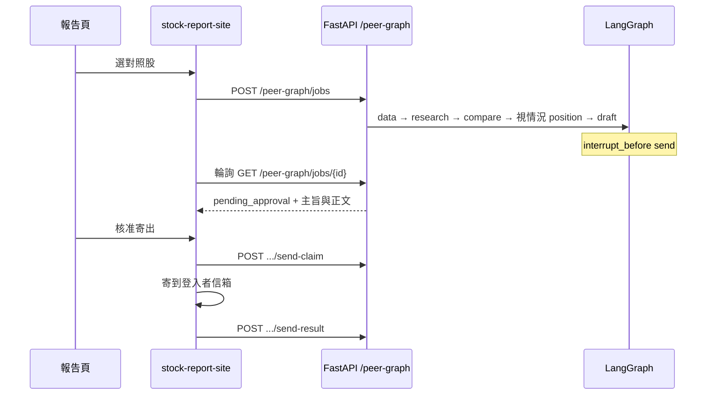

# 概念股比較：網站決策圖

報告頁選一檔同主題對照股之後，系統要自己決定：資料齊不齊、要不要跑本檔研究、規則上誰比較弱、有持倉時要不要做部位、比較信草稿怎麼寫、以及寄出前停在哪裡等人核准。

這條用 **LangGraph** 把上述步驟編成一張狀態圖（`agent/web_graph.py`）。它是網站上的一個產品，不是 Phase 2 的一句話 orchestrator，也不是 Phase 5 的 Agent2Agent。MCP 與 A2A **不** import 這張圖。強弱與數字仍由規則算；模型只解釋已定結論。

日常入口是報告頁。API 隨 `python main.py api`（`--extra server`，內含 `langgraph`）。總架構裡它和 orchestrator 並列，見 [`agent-roadmap.md`](./agent-roadmap.md) §3。

---

## 1. 為什麼用一張圖，而不是再叫一次 orchestrator

Orchestrator 回答的是「這句話要跑哪些 tool」：處理持股、單檔要不要動、明天開盤怎麼看。概念股比較的分支是固定的，而且分支條件必須可測：

- 沒有同日 facts 就不能比。
- 對照股必須在 `concept_peers_universe.json` 的同一主題裡。
- **只有本檔規則上較弱、而且有持倉**，才跑部位。
- 比較信寫完就停，寄出要人核准。網站寄信；本 repo 的 `send_digest` 仍是關的。

這些條件若交給意圖模型現編 plan，信裡的「較弱」可能和實際有沒有跑部位不一致。LangGraph 在這裡只負責狀態與分支：每個節點呼叫既有的 `agent.tools`，不重寫 gate。

---

## 2. 決策流程

`data`、`research`、`compare` 失敗就結束，不寫信。網站目前送 `fetch: false`：沒有 facts 就停，不在這張圖裡補抓。

部位略過的原因寫進信裡，例如本檔並未弱於同業，或沒有持倉。研究只跑本檔；對照檔只出現在規則比較的句子裡。

---

## 3. 信怎麼分成兩層

主旨與開頭用 **股名**（友達 相對 群創），不用股號。股名來自同日 facts。

| 誰寫 | 內容 |
|---|---|
| 程式 | 比較結論、同日事實、共同題材、部位路徑或略過原因 |
| 模型 | 「怎麼讀這次比較」「和本檔研究的關係」「接下來看什麼」；有部位報告才加「部位含義」 |

模型第一句必須沿用已定標籤（相對同業：較弱／較強／分歧／無法判斷）。它不能重算強弱，也不能寫出結論裡沒有的百分比、張數或價位，也不能改用股號。檢查沒過會重寫一次；第二次仍失敗，信退回純規則結論，並註明解讀未生成。

草稿：`reports/digest/{日期}/peer_{本檔代號}_{對照代號}.md`。檔名仍用代號，是為了對檔；正文用股名。

---

## 4. HTTP 與網站怎麼接

| 方法 | 路徑 | 行為 |
|---|---|---|
| `POST` | `/peer-graph/jobs` | 排隊。本檔與對照相同 → 400。聲稱有持股卻沒有張數或均價 → 400 |
| `GET` | `/peer-graph/jobs/{id}` | 查狀態。沒有這筆 → 404 |
| `POST` | `/peer-graph/jobs/{id}/send-claim` | 只有 `pending_approval` 且草稿齊全才能改成 `sending` |
| `POST` | `/peer-graph/jobs/{id}/send-result` | 網站寄完回寫 `sent`，失敗則退回 `pending_approval` |

網站路由是 `/api/peer-graph`。寄信在 `stock-report-site`，本 API 不發信。

---

## 5. 和另外兩條編排的差別

| | 概念股比較 | Orchestrator | A2A |
|---|---|---|---|
| 入口 | 報告頁 | `python main.py agent` | `python main.py a2a` |
| 編排 | LangGraph 固定分支 | 意圖 → plan → policy | Card／task，被叫到仍進 orchestrator |
| 模型決定什麼 | 只解釋已定強弱 | 可提議 tool 序列，執行前要過 schema | 不另做一套決策 |
| 寄信 | 人核准後由網站寄 | `send_digest` 預設 blocked | 同左 |

投組組倉仍是另一條線（規則配權，見 [`portfolio.md`](./portfolio.md)）。`concept_peers_universe.json` 只提供誰可以當對照，不參與選股配權。
