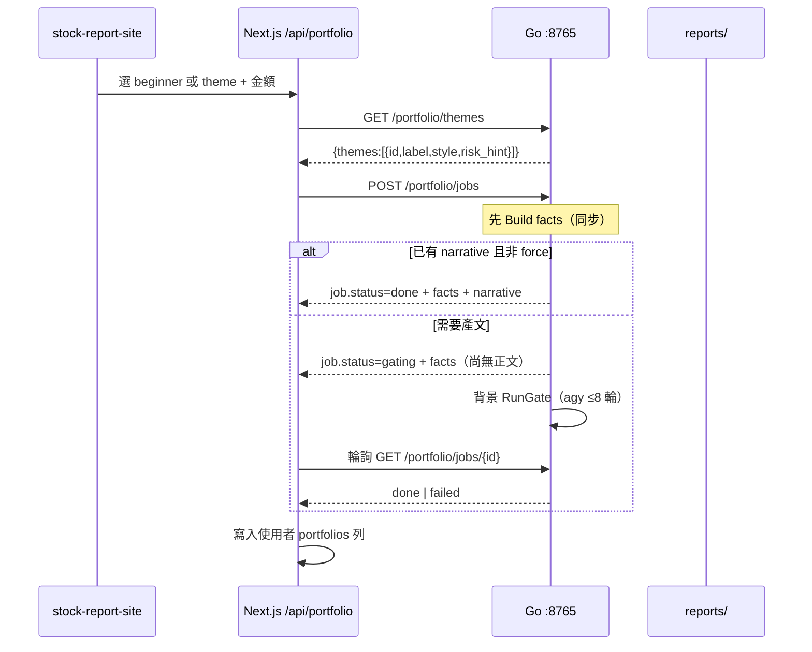
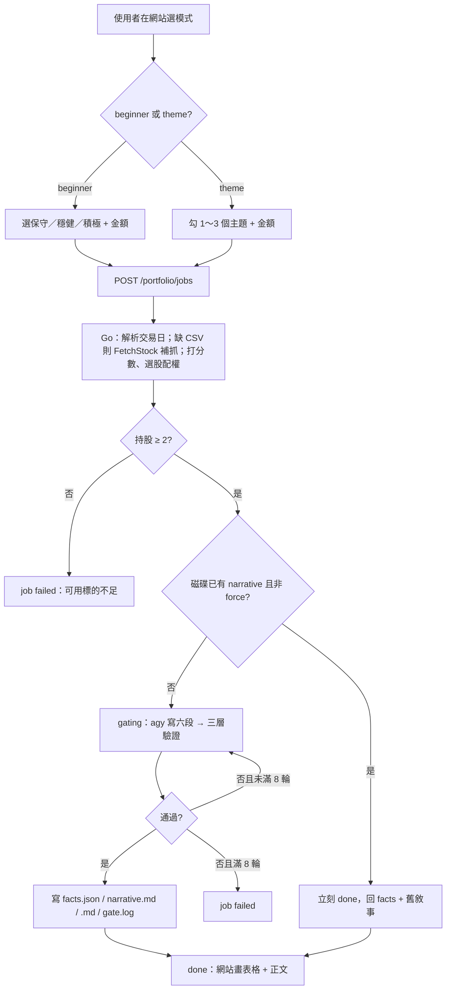

# 投資組合（Portfolio）：概念、架構與流程

這條線解決的問題是：**依風險屬性或主題，從既有籌碼快照裡「規則選股、規則配權」，再用語言模型寫給人看的說明**。數字（誰進組合、各佔幾%、試算金額／股數）永遠由系統決定；agy 只寫敘事。網站（`stock-report-site`）負責 UI 與歷史紀錄，Go Stock API（`stock-winning-rate-Go`，預設 `:8765`）負責配置與 gate。

日常對接：Next.js → `POST/GET /portfolio/jobs`、`GET /portfolio`、`GET /portfolio/themes`。不要把這條線跟 MCP／Agent2Agent 混在一起。

---

## 1. 核心原則

```text
候選池 JSON  +  當日 ChipFacts（CSV）
        │
        ▼
   規則層（Go / 原 Python portfolio_signals）
   · 資格過濾
   · 健康分數（籌碼 + base_rates 傾斜，不含基本面）
   · 選股（新手：ETF 核心 + 每產業至多一檔；主題：同主題可同產業）
   · 配權（依分數 water-fill，單檔上限，新手再強制 ETF 核心佔比）
   · 權重四捨五入加總 100
        │
        ▼
   PortfolioFacts（唯一事實來源）
        │
        ├─ 網站表格直接畫 facts（權重／金額／角色）
        └─ agy 只讀 facts 摘要 → 寫六段白話
                │
                ▼
           三層驗證（format / facts / reasoning）
           不合格就把問題餵回 agy，最多 8 輪
```

- **規則擁有判決**：能不能進、分數多少、選誰、各佔幾%，全部確定性。同一日、同一候選池、同一 profile／themes，結果可重現。
- **agy 擁有敘事**：一句話總結、適合誰、每檔為什麼、風險、紀律、免責。不可改數字、不可加未選入的股票、不可寫保證／目標價。
- **網站不重算權重**：`facts` 進 Supabase／畫面；narrative 另欄。表格與正文拆開，避免 LLM 把 35% 寫成 40%。

Go 移植刻意 **略過基本面**（對齊 Python `--skip-fundamentals`）：評分只有籌碼健康 + `base_rates` 前向 edge + 波動懲罰。缺基本面時會在 `warnings` 註明「本次僅依籌碼評分」。

---

## 2. 兩種模式

| | 新手 `beginner` | 主題 `theme` |
|---|---|---|
| 使用者輸入 | `profile`：conservative / balanced / aggressive；`amount` ≥ 5 萬 | `themes`：1～3 個主題 id（如 `financials` 或 `financials,thermal`）；`amount` ≥ 5 萬 |
| 候選池 | `portfolio_universe.json`（市值／高股息 ETF + 權值藍籌） | `portfolio_theme_universe.json`（主題 ETF + 主題個股）。報告頁概念股比較用另一份 `concept_peers_universe.json`，不參與本節選股；比較決策見 [`peer-graph.md`](./peer-graph.md) |
| 定位 | 全倉新手底倉：ETF 打底、產業分散 | **袖口**，不是全市場分散；可疊在既有部位上 |
| 選股 | ETF 優先各類各挑、個股每 sector 至多 1 檔 | 先主題 ETF，再依主題名額挑個股；同主題可同產業 |
| 權重 | 分數 water-fill + 單檔上限 + **ETF 核心最低佔比** | 分數 water-fill；持股少時放寬單檔上限以免加不滿 100% |
| `artifact_key` | `conservative` / `balanced` / `aggressive` | `theme_` + 排序後的 theme id（例 `theme_financials_thermal`） |
| 風險標籤 | 低／中／中高風險 | 依主題 style（defensive / growth / cyclical）組出「主題集中」標籤 |
| 驗證額外約束 | 保守型禁「積極／高風險」；須解釋 ETF 分散 | 禁「保本／全市場分散」；須點出袖口／集中 |

`amount` 只做試算（各檔 `allocation_twd`、`est_shares`），不影響誰被選入。

---

## 3. 確定性配置怎麼算

### 3.1 資料從哪來

1. 交易日：請求帶 `date`／`trade_date` 就用它；否則取 `reports/stock/` 底下最新的日期目錄。沒有任何日期 → 422「找不到可用交易日…」。
2. 個股 CSV：先 `reports/stock/{date}/{id}/tw_stock_{id}.csv`，沒有再退回扁平 `reports/stock/{date}/tw_stock_{id}.csv`。可選 `{stem}_history.csv`。
3. **缺檔時自動補抓**：與圖表 on-demand 相同，呼叫既有 `FetchStock`（只寫 CSV／facts，不跑 agy／gate）。新手補整個候選池；主題只補所選 themes 的標的。並行上限 4；單檔失敗略過並寫入 `warnings`，不整份失敗。
4. `ChipFacts`：與個股報告同一套 `BuildChipFacts`。補抓後仍沒有 CSV 的候選標＝`data_available=false`，不進池。
5. `base_rates`：`reports/calibration/base_rates.json`（沒有就當 0）。`ForwardEdge` → 分數 ±6。
6. 補抓後全池仍沒資料 → 422（新手／主題各有一句話）。

第一次產組合會比「CSV 已齊」慢（FinMind／Yahoo）；之後同一交易日直接讀檔。

### 3.2 分數（chip-only）

```
beginner_score = 類別基礎分[profile][category]
               + beginner_core(+4) + defensive 加成
               + chip_health(profile) + base_rate_score + volatility_penalty

theme_score    = 類別基礎分[category]
               + chip_health(aggressive) + base_rate_score + volatility_penalty(aggressive)
```

`chip_health` 看籌碼型態、均線堆疊／斜率、價格趨勢、相對大盤、趨勢強度、RSI、法人共識，方向有正有負。高波動在保守型幾乎直接出局（資格過濾），積極型只小扣分。

### 3.3 新手資格與選股

保守型排除：高波動個股、航運、籌碼偏空、當沖過熱。穩健型排除高波動與航運。積極型都允許。

選股順序：

1. ETF：先每種類別各挑分數最高的 1 檔，再補到 `max_etf_picks`。
2. 個股：分數高者優先，**每個 sector 最多 1 檔**，直到 `max_holdings`。

Python 還有「估值桶」軟性分散；Go 沒有基本面，估值桶一律 `unknown`，這段不觸發。

### 3.4 配權

分數若有 ≤0，先平移到全正。依分數比例縮放到 100，超過單檔上限的溢出用水位填充分給其他人。新手再把 ETF 合計拉到 `etf_core_min_weight`（60 / 40 / 25），然後再 water-fill 一次。最後把小數歸到 100。

主題模式不強制 ETF 佔比；持股 n 檔時單檔上限至少 `ceil(100/n)`，避免 3×30% 加不滿。

---

## 4. 三層驗證（agy 敘事）

對齊 `validate_portfolio_report.py`。issue code 前綴決定層：

| 層 | 前綴 | 在查什麼 |
|---|---|---|
| format | （無前綴） | ≥200 字；點出組合名稱／主題／每一檔持股；有適合、風險／波動、紀律、免責；禁「保證／穩賺／一定漲／目標價／工作摘要」 |
| facts | `portfolio_fact_` | 風險用詞對齊屬性；主題不可寫成保本／全市場分散；**不可把 excluded 股票寫成建議買進** |
| reasoning | `portfolio_reasoning_` | 紀律至少涵蓋「下跌／退潮、分批、定期檢視」三組中的兩組；新手須提到分散／一籃子；主題須提到集中／袖口；「適合誰」附近要有對應特性詞 |

不合格的 code 會換成修正指引，整份舊正文 + facts 再丟回 agy。最多 **8** 輪。持股少於 2 檔不進 agy，job 直接失敗。

通過後寫：

```text
reports/portfolio/{date}/
  portfolio_{artifact_key}.facts.json
  portfolio_{artifact_key}.narrative.md   # 純敘事（網站用這個，不重複表格）
  portfolio_{artifact_key}.md             # 報告資訊 + 規則表格 + --- + 敘事
  portfolio_{artifact_key}.gate.log       # JSONL
  portfolio_{artifact_key}.gate.rounds/   # rNN.prompt.txt / body.md / validation.json
```

`GET`／`POST` 若已有 `.narrative.md`（或舊版 `.md` 能拆出敘事）且請求沒帶 `force=true`，**重用舊敘事、不再呼叫 agy**。facts 每次都依當日 CSV 重算。

---

## 5. HTTP 與網站怎麼接



| 方法 | 路徑 | 行為 |
|---|---|---|
| `GET` | `/portfolio/themes` | 內嵌主題目錄 |
| `GET` | `/portfolio?mode=&profile=&themes=&amount=&date=` | 只算 facts + 讀既有敘事，**不跑 agy** |
| `POST` | `/portfolio/jobs` | 先算 facts；無敘事或 `force` 則背景 gate |
| `GET` | `/portfolio/jobs/{id}` | 查狀態；`gating` 時已帶當次 facts |

請求預檢在 `internal/contract`：

- `mode`：`beginner`（預設）或 `theme`
- beginner 必填合法 `profile`
- theme 必填 `themes`
- `amount` ≥ 50000（POST 必填；GET 可省略）
- `trade_date`／`date` 若有須 `YYYY-MM-DD`

錯誤一律 `{"detail":"..."}`。建 facts 失敗（沒交易日、沒候選 CSV）→ **422**。找不到 job → 404「找不到 portfolio job」。

Job 形狀對齊 Python `PortfolioJob.to_dict()`：`id`、`profile`（此處是 `artifact_key`）、`status`、`amount`、`trade_date`、`portfolio`（`facts`／`narrative`／`has_narrative`／`generated_via`／`artifact_key`）、`mode`、`themes`。

網站端：`lib/agent-client.ts` 打上述 API；`app/api/portfolio` 把結果存進使用者自己的 `portfolios` 列。**不要改網站**就能接 Go，因為契約沒變。

---

## 6. 套件落點（Go）

```text
internal/harness/portfolio/     規則 + 驗證 + prompt + gate
  data/*.json                  與 Python portfolio-gate 同一份候選池
  score.go / beginner.go / theme.go
  assemble.go / render.go      facts 組裝、表格 Markdown、prompt 摘要
  validate.go / prompt.go / gate.go
internal/jobs/portfolio.go     記憶體 PortfolioStore（與個股 jobs.Store 分開）
internal/contract/portfolio.go 公開請求預檢
internal/server                GET/POST 路由；不直接呼叫 agy
```

依賴方向與個股報告相同：`server` → `jobs`／`contract`／`portfolio.Build`；`jobs.PortfolioStore` 才編排 `portfolio.RunGate` → `agy`。個股 `JOB_MAX_CONCURRENCY` **不管** portfolio job（對齊 Python 獨立 thread）。

---

## 7. 端到端流程（使用者視角）



個股深度報告不是前置條件。缺的候選 CSV 會在組倉時自動補抓；失敗的檔才會在警告裡列出。

---

## 8. 和 Python 版的對照

| 項目 | Python `stock-winning-rate` | Go `stock-winning-rate-Go` |
|---|---|---|
| 規則與驗證 | `ui/portfolio_signals.py` + `portfolio-gate/` | `internal/harness/portfolio` |
| 基本面 | 預設抓 PER／殖利率／營收；可 `--skip-fundamentals` | **固定略過**（籌碼 + base_rates） |
| HTTP | FastAPI `api/stock_api.py` | `internal/server` + `jobs.PortfolioStore` |
| 產文 | subprocess `portfolio_gate.py` | 同 process 呼叫 `agy` |
| 網站契約 | 不變 | 對齊同一組 path／JSON |
| PDF | 可選 | 不產（`skip_pdf` 預設 true） |

概念與流程以此文件為準；Go 套件分層細節見 `stock-winning-rate-Go/docs/architecture.md`。
